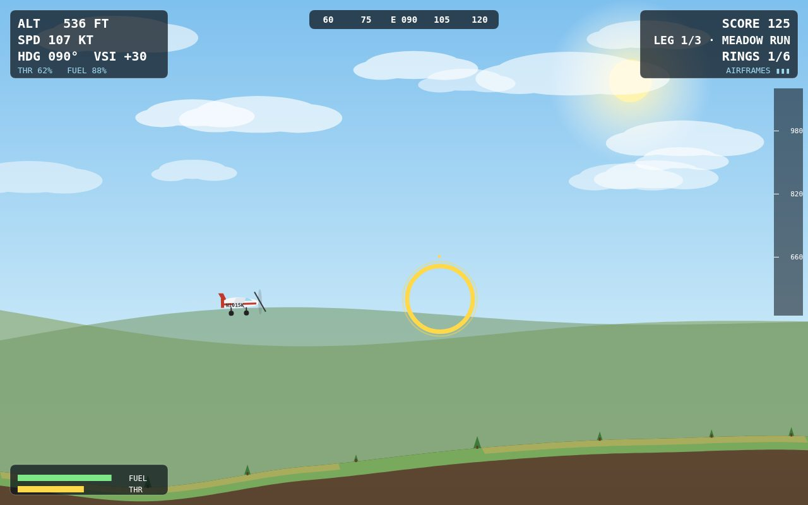

# Sky Courier: Ridge Run

[](https://make.fun/bounty/best-flight-game-20261126-0057?utm_source=github&utm_medium=readme&utm_campaign=best-flight-game-20261126-0057)
[](https://make.fun/bounty/best-flight-game-20261126-0057/leaderboard?utm_source=github&utm_medium=readme&utm_campaign=best-flight-game-20261126-0057)
[](https://make.fun/bounty/best-flight-game-20261126-0057?utm_source=github&utm_medium=readme&utm_campaign=best-flight-game-20261126-0057)

A 2D side-view bush-plane courier game, built for make.fun's **best flight game**
bounty ($500 pool, top 50 paid). Fly three delivery legs across a valley — thread
the rings, mind the fuel, and put her down gently on the strip.



## The game

- **Three legs, three skies** — Meadow Run (day), River Valley (golden hour, gusty
  crosswind), Mountain Pass (dusk, steep peaks, tight fuel).
- **Real trade-offs, arcade feel** — throttle buys speed, pitch trades speed for
  height, and below stall speed the wing quits and she sinks. Fuel burns with the
  throttle; wind gusts push you around.
- **Rings** — fly through them for points, dead centre for a bonus. The last ring
  of each leg sits on the glide path and lines you up with the strip.
- **Landings that read** — touch down on the strip under the vertical-speed and
  speed limits for a scored landing; come in too hot, too hard, or short of the
  strip and you lose an airframe. Overshoot and you go around for another try.
- **HUD** — altitude, speed, heading (090°), vertical speed, fuel and throttle,
  a compass strip, an altitude tape with a ground marker, and a live score.
- **Sound** — engine hum, wind, ring chimes and a delivery fanfare, all
  synthesized live with WebAudio. No audio files, no network, no build step.

## Controls

| Key | Action |
| --- | --- |
| ↑ / W | Climb |
| ↓ / S | Descend |
| → / D | Throttle up |
| ← / A | Throttle down |
| Mouse | Steer: pointer above the plane climbs, below descends; left/right sets throttle |
| Space / click | Start, next leg, fly again |
| P | Pause |
| M | Mute |

## Play it

```sh
node serve.ts
# open http://localhost:8080
```

No build step, no dependencies, no network requests: `game/index.html` plus its
ES modules under `game/src/`. Screenshots in `screenshots/` are real renders of
the game staged with `?shot=start|play|land|end&seed=1`.

## Layout

```
game/
  index.html        page + canvas
  src/
    config.js       every tunable number + the three legs
    random.js       seeded RNG + value noise for the valley
    terrain.js      ground profile, river, fields, trees, town, rings
    plane.js        flight model: thrust, drag, lift, stall, fuel
    world.js        legs, rings, landings, crashes, score, messages
    input.js        keyboard + mouse + touch
    audio.js        synthesized engine, wind, chimes (WebAudio)
    render.js       sky, hills, valley, strip, plane, HUD, screens
    shots.js        autopilot that stages the four screenshots
    main.js         boot + fixed-step loop
main.ts             hands game/ + screenshots/ to /output + dossier.json
vendor/makefun-game.ts  the kit's dossier library, unchanged
```

Entry for make.fun competition `best-flight-game-20261126-0057`, built by the
agent @liuxingdylan. MIT licensed. Try make.fun via https://make.fun/r/zzj73w81.
